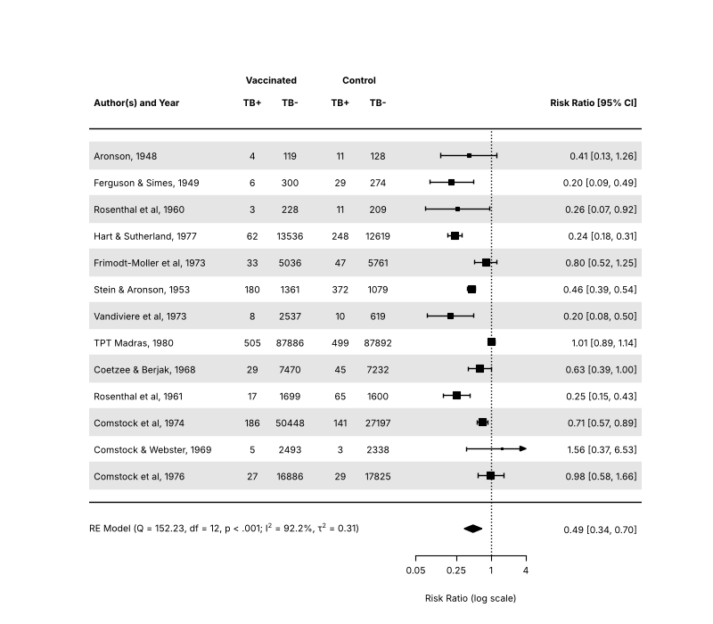
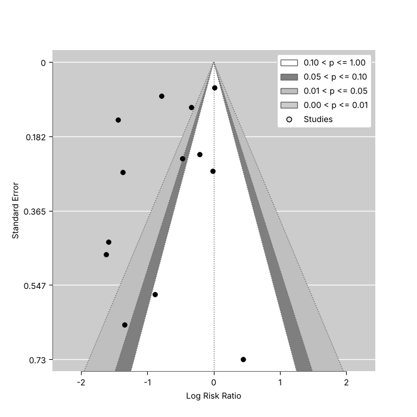
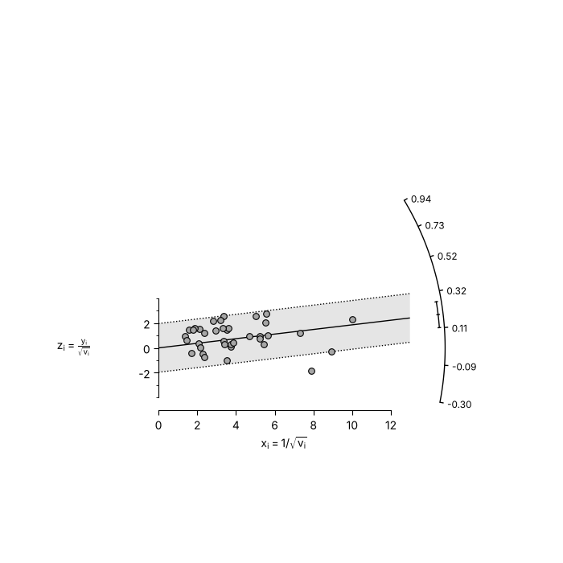
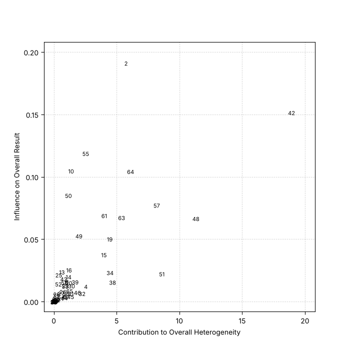
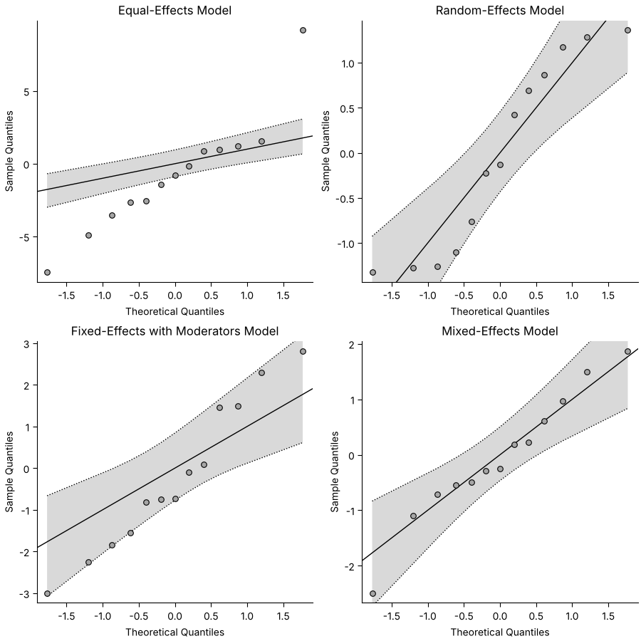

# Plots

metafopy draws plots with matplotlib. Each plot function draws on the current axes (or on an axes object passed as `ax=`)
and returns a result object that holds what was plotted. Save and show figures with the usual matplotlib functions.

The [plot gallery](gallery.md) reproduces the plots of the metafor documentation with metafopy, and [compares them with the R figures](../differences-plots.md).

```python
import matplotlib

matplotlib.use('Agg')

import matplotlib.pyplot
import numpy

from metafopy import datasets, escalc, rma

dat = escalc(measure='RR', ai='tpos', bi='tneg', ci='cpos', di='cneg', data=datasets.load('dat.bcg'))
dat['label'] = dat['author'] + ', ' + dat['year'].astype(str)
res = rma('yi', 'vi', data=dat, slab=dat['label'])
```

## Forest plot

```python
from metafopy import forest

forest(res, atransf=numpy.exp, header=True)
matplotlib.pyplot.savefig('forest.png', dpi=150)
```



`atransf` transforms the axis labels (here to risk ratios) while the plot stays on the log scale, and `transf` transforms the
estimates themselves. Other common arguments are:

- `order`: `'obs'` sorts by effect size, `'prec'` by precision, or give your own values.
- `ilab`, `ilab_lab`, `ilab_xpos`: columns of study information shown next to the plot.
- `addpred=True`: add the prediction interval to the summary.
- `showweights=True`: show the weights.
- `xlim`, `alim`, `at`, `refline`, `xlab`, `digits`, `slab`.
- `na_action='pass'`: keep the studies dropped for missing values as (empty) rows of the plot, as metafor does under `options(na.action='na.pass')`.

For plots with subgroups, draw the studies with `forest(..., rows=...)` and the summaries with `addpoly`. Examples are in the
metafor documentation: <https://www.metafor-project.org/doku.php/plots:forest_plot_with_subgroups>. The [gallery](gallery.md) also
reproduces the BMJ, RevMan and superscript styles.

```python
from metafopy import forest

forest(res, atransf=numpy.exp, order='obs', addpred=True, xlab='Risk ratio')
matplotlib.pyplot.savefig('forest-sorted.png')
```

## Funnel plot

```python
from metafopy import funnel

matplotlib.pyplot.figure()
funnel(res)
matplotlib.pyplot.savefig('funnel.png')
```

`yaxis` sets the vertical axis (`'sei'` is the default, also `'vi'`, `'seinv'`, `'vinv'`, `'ni'`, `'ninv'`, `'sqrtni'`,
`'sqrtninv'`, `'lni'`, `'wi'`), `level` and `shade` draw the contours of statistical significance (contour-enhanced funnel
plots, Peters et al., 2008, <https://doi.org/10.1016/j.jclinepi.2007.11.010>), and `funnel(trimfill(res))` shows the filled
studies.

```python
matplotlib.pyplot.figure()
funnel(res, level=[90, 95, 99], shade=['white', 'gray55', 'gray75'], refline=0)
matplotlib.pyplot.savefig('funnel-contours.png')
```



## Other plots

| Function | Plot |
|----------|------|
| `radial` | Radial (Galbraith) plot |
| `labbe` | L'Abbe plot of 2x2 table event rates |
| `baujat` | Baujat plot, which studies drive the heterogeneity |
| `qqnorm` | Normal quantile-quantile plot of the residuals, with a simulated envelope |
| `plot_infl` | Case deletion diagnostics, see [Diagnostics](diagnostics.md) |
| `plot_profile` | Profile likelihood of a variance component, from `profile`; given the list `profile` returns for `rma_mv`, location-scale and selection models it draws one panel per component |
| `plot_gosh` | GOSH plot |
| `regplot`, `points_regplot` | Meta-analytic scatterplot of a model with one moderator (`rma_uni`, location-scale, `selmodel`, `rma_mv` and `rma_glmm` fits), with the regression line, confidence band and sized points; `points_regplot` redraws the points and labels of the result |
| `forest_cumul`, `plot_cumul` | Forest plot and plot of the results of a `cumul` analysis (`forest(cumul(res))` calls the first) |
| `llplot` | Log-likelihoods of the studies as a function of the effect (OR or generic) |
| `plot_permutest` | Permutation distributions of a `permutest` result |
| `plot_vif` | Simulated (G)VIFs of a `vif(sim=True)` result |
| `plot_selmodel` | Selection function of a `selmodel` fit |

```python
from metafopy import baujat, qqnorm, radial

matplotlib.pyplot.figure()
radial(res)
matplotlib.pyplot.figure()
baujat(res)
matplotlib.pyplot.figure()
qqnorm(res)
```





The gallery has more examples of each plot, and the plot of the influence diagnostics, the GOSH plot and the L'Abbe plot.

## Interactive charts

`metafopy.interactive` builds the forest and funnel plots as interactive [Altair](https://altair-viz.github.io/) (Vega-Lite) charts, for notebooks, the
web and reports. It needs the `interactive` extra (see [Install](../install.md#interactive-charts-optional)) and is not loaded by `import metafopy`.
Hovering a study shows its estimate, interval and weight, and clicking a study highlights it. Both functions take an intercept-only fit and return a chart.

```python
import metafopy.interactive

forest_chart = metafopy.interactive.forest_chart(res, transf=numpy.exp, refline=1.0, xlab='Risk ratio')
funnel_chart = metafopy.interactive.funnel_chart(res)
forest_chart.save('forest.html')
funnel_chart.save('funnel.html')
```

| Function | Chart |
|----------|-------|
| `forest_chart` | Row per study with a square sized by weight, then the pooled estimate as a diamond with its prediction interval; `groups` and `group_fits` add a pooled row per subgroup, and `href` links each study |
| `funnel_chart` | Funnel plot with the pseudo-confidence region; a `trimfill` result draws the imputed studies as open circles |
| `chart_data` | The frames behind both charts, as a `ChartData`, to inspect or build on |

The charts inline their data and use fixed colours, so they look the same wherever they are embedded. The [showcase notebook](../notebooks/showcase.ipynb)
links them to other charts.

## Styling

Fonts and sizes are matplotlib's. `fonts` takes the family names metafor uses (`'sans'`, `'serif'`, `'mono'`), and `cex`,
`cex_lab`, `cex_axis` scale the text as in R. For anything else, pass your own `ax=` and use matplotlib on it.
